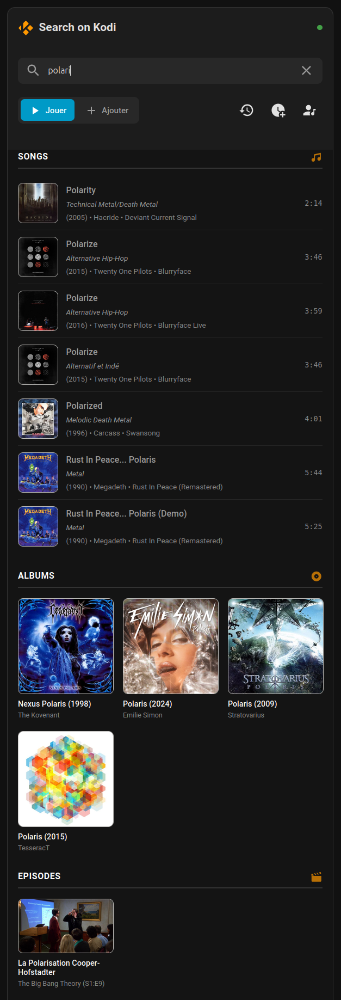
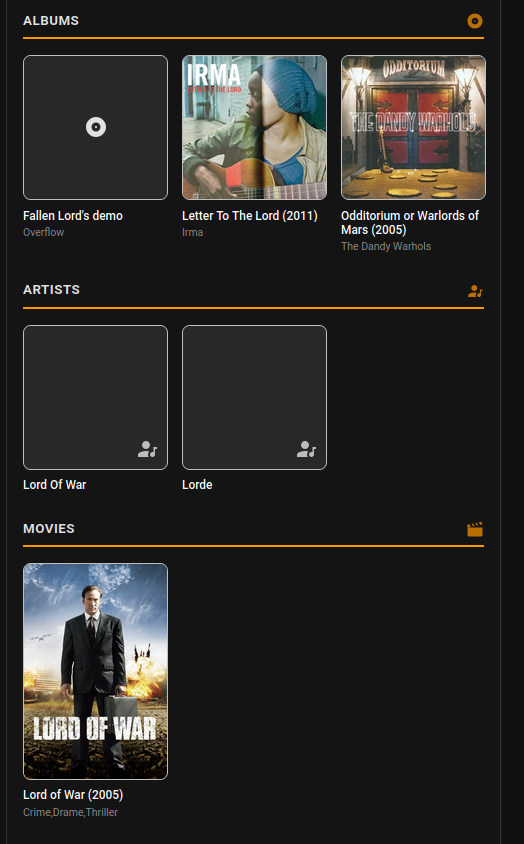

[![HACS Default][hacs_shield]][hacs]
[![Buy me a coffee][buy_me_a_coffee_shield]][buy_me_a_coffee]

[hacs_shield]: https://img.shields.io/static/v1.svg?label=HACS&message=Default&style=popout&color=green&labelColor=41bdf5&logo=HomeAssistantCommunityStore&logoColor=white
[hacs]: https://hacs.xyz/docs/default_repositories

[buy_me_a_coffee_shield]: https://img.shields.io/static/v1.svg?label=%20&message=Buy%20me%20a%20coffee&color=6f4e37&logo=buy%20me%20a%20coffee&logoColor=white
[buy_me_a_coffee]: https://www.buymeacoffee.com/jtbgroup

# Kodi-Search-Card

This card displays a search form to query the kodi entity.

This card is intented to be an alternative to an iframe containing Chorus.

| Search Form | Search Form |
| ---- | ---- |
|  |  |


## Requirements

This card requires the search sensor provided by [Kodi Media Sensors](https://github.com/jtbgroup/kodi-media-sensors) v6.0.0 or later.

## Features

The card lets you search Kodi media and browse recently added or played items, the current artist, and music playlists. You can play items or add them to a Kodi playlist.

Search results can include songs, albums, artists, movies, TV shows, episodes, music videos, and PVR channels (when a PVR client add-on is present). Artist and TV show results support drill-down; music playlist directories can be browsed.

## Installation

1. Install the custom component [Kodi Media Sensors](https://github.com/jtbgroup/kodi-media-sensors).
2. Install the card using HACS

Manual installation is of course possible, but not explained here as there are plenty of tutorials.

## Card options

| Name | Type | Default | Since | Description |
|------|------|---------|-------|-------------|
| type | string	| **required** | v1.0.0 | `custom:kodi-search-card` |
| entity | string | **required** | v1.0.0 | Entity ID of the search sensor provided by Kodi Media Sensors, for example `sensor.kodi_media_sensor_search`. |
| title | string | optional | v1.0.0 | The title of the card |
| show_thumbnail | boolean | `true` | v1.0.0 | Shows thumbnails from Kodi. Disable this if mixed HTTP/HTTPS content causes loading problems. |
| show_thumbnail_overlay | boolean | `true` | v2.1 | Adds a light overlay over thumbnails to improve the visibility of the action icon. |
| show_thumbnail_border | boolean | `true` | v2.1 | Adds a 1px border around thumbnails. |
| outline_color | string | optional | v2.1 | Border color when **show_thumbnail_border** is enabled. Accepts a CSS color value, including named colors, RGB, hex, and CSS variables. |
| album_details_sort | string | `date_desc` | 2.5.0 | Sorts albums when drilling down into an artist. Values: `date_asc`, `date_desc`, `title_asc`, or `title_desc`. |
| show_action_mode | boolean | `true` | 2.6.0 | Shows or hides the Play/Add selector. When hidden, `action_mode` determines the action. |
| show_recently_added | boolean | `true` | 3.4.0 | Shows or hides the Recently Added navigation button. |
| show_recently_played | boolean | `true` | 3.4.0 | Shows or hides the Recently Played navigation button. |
| show_current_artist | boolean | `true` | — | Shows or hides the Current Artist navigation button. |
| show_music_playlist | boolean | `true` | — | Shows or hides the Music Playlists navigation button. |
| action_mode | string | `play` | 2.6.0 | Default action for item clicks: `play` or `add`. If the action selector is visible, the user's selection takes precedence. |
| add_position | string | `last` | 2.6.0 | Playlist position when `action_mode` is `add`: `next` or `last`. |
| media_type_order | list | `song`, `album`, `artist`, `movie`, `musicvideo`, `tvshow`, `episode`, `channel`, `musicplaylist` | 2.7.0 | Controls the order of returned media categories. Categories shown depend on the Kodi Media Sensors integration and its configuration. When setting a custom list, include every category you want displayed; categories not listed are hidden. |
| show_version | boolean | `false` | 5.0.1 | Shows the card version in the footer. |

Example:

``` yaml
    type: custom:kodi-search-card
    entity: sensor.kodi_media_sensor_search
    title: What an amazing Card!!!
    show_version: true
    show_thumbnail: true
    show_thumbnail_border: true
    show_thumbnail_overlay: true
    album_details_sort: title_desc
    show_action_mode: true
    action_mode: add
    outline_color: rgb(74,200,50)
    add_position: last
    media_type_order:
        - movie
        - album
        - song
        - episode
```
